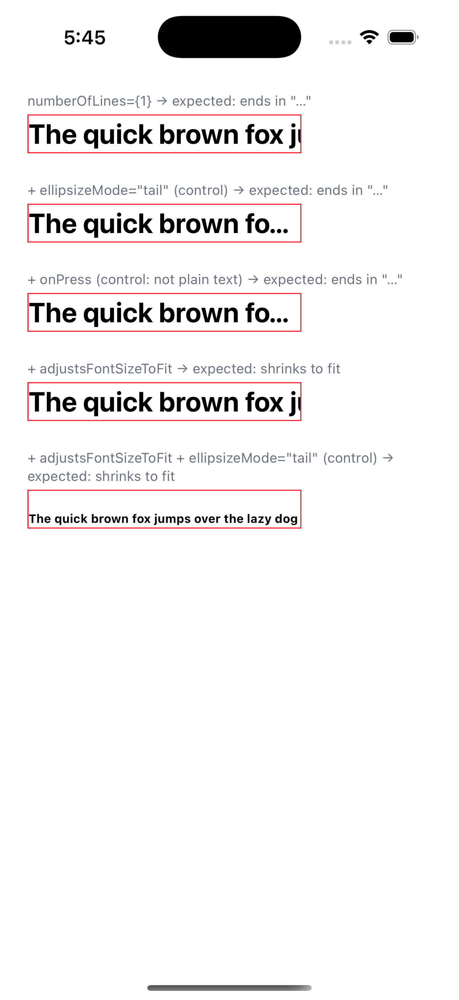
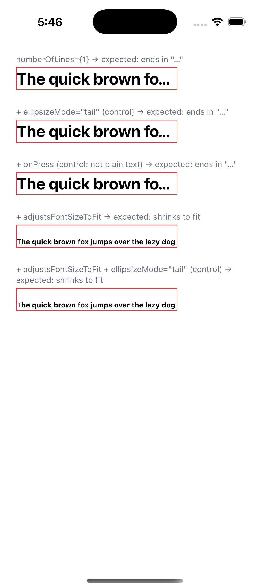

# Uniwind Pro 1.8.1: `<Text numberOfLines>` clips instead of truncating

On Pro 1.8.1, a plain `<Text numberOfLines={1}>` that overflows is clipped mid-glyph with no `…`, and `adjustsFontSizeToFit` stops shrinking it. An explicit `ellipsizeMode="tail"` fixes both, as does anything that routes the Text through React Native's own `Text` (e.g. an `onPress`).

```sh
bun install          # needs Uniwind Pro credentials
bun ios              # expo run:ios
```

`App.tsx` renders the same long string in a fixed-width box five times. On Pro 1.8.1 / RN 0.86.3 / iOS 26:

| Case | Expected | Actual |
| --- | --- | --- |
| `numberOfLines={1}` | ends in `…` | **clipped** |
| `+ ellipsizeMode="tail"` (control) | ends in `…` | ends in `…` |
| `+ onPress` (control, not plain text) | ends in `…` | ends in `…` |
| `+ adjustsFontSizeToFit` | shrinks to fit | **clipped, not shrunk** |
| `+ adjustsFontSizeToFit` `ellipsizeMode="tail"` (control) | shrinks to fit | shrinks to fit |

| Pro 1.8.1 | Pro 1.8.1 + one-line fix below |
| --- | --- |
|  |  |

## Why

React Native's `Text.js` defaults the prop before rendering the host component:

```js
processedProps.ellipsizeMode = ellipsizeMode ?? 'tail';
```

Pro 1.8.1's `Text` sends plain text straight to `NativeText` (`Text.tsx`: `isPlainText(props)` → `toNativeTextProps(props)` → `AccessibleText`). Because `isTextAccessible` returns `false` whenever `numberOfLines` is set, every plain-text `numberOfLines` Text goes through `toNativeTextProps`. That function mirrors `Text.js`'s prop processing (`aria-*`, `nativeID`, `numberOfLines`, `selectionColor`, `fontWeight`, `userSelect`, `verticalAlign`) but never sets `ellipsizeMode`. The native `ParagraphAttributes::ellipsizeMode` then zero-initialises to `EllipsizeMode::Clip`.

Clip mode also breaks `adjustsFontSizeToFit` on iOS: `NSTextStorage+FontScaling` detects overflow with `truncatedGlyphRangeInLineFragmentForGlyphAtIndex`, which only reports truncation under a truncating line-break mode, so the text always "fits" and never shrinks.

In 1.7.0, any `numberOfLines` Text was excluded from the fast path (`hasNumberOfLines` in `isTextAccessible`) and rendered through `RNText`, so the missing default never surfaced.

## Fix (verified against this repro)

`src/components/native/utils/accessibility.ts`, in `toNativeTextProps`, after the `numberOfLines` block:

```ts
processedProps.ellipsizeMode = otherProps.ellipsizeMode ?? 'tail'
```
